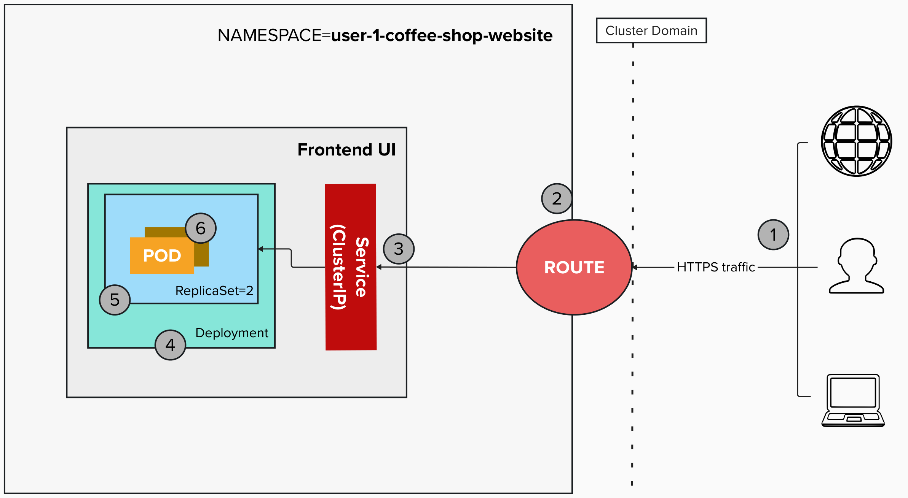

# Coffee Shop Website

A landing page for a specialty coffee shop, served with **Node.js + Express** inside a Docker container.

## Architecture



---

## Files

```
.
├── Dockerfile           # Image definition (Node.js 20 Alpine, non-root user)
├── app.js               # Express server — serves src/ as static files on port 8080
├── package.json         # Dependencies (express)
├── deployment.yaml      # Deployment with 2 replicas
├── service-route.yaml   # Service on port 8080 and a Route with edge TLS
└── src/
    ├── index.html       # Main page
    ├── styles.css       # All styles
    └── main.js          # Client-side JS (nav toggle, order buttons)
```

---

## Lab steps
## Before continuing with the instructions, ensure you are logged in! Do this for every lab!!!
```bash
! crc start
oc login -u developer -p developer https://api.crc.testing:6443
```

### 0. Create the project and set the namespace variable

**Linux / macOS:**

```bash
export NAMESPACE=$(oc whoami)-coffee-shop-website
oc new-project $NAMESPACE

# Make sure to be at the right directory
cd day-2/labs/coffee-shop-website
```

**Windows (PowerShell):**

```powershell
# Replace <username> with your username (e.g. developer)
$env:NAMESPACE = "<username>-coffee-shop-website"
oc new-project $env:NAMESPACE

# Make sure to be at the right directory
cd day-2\labs\coffee-shop-website
```

---

### 1. Inspect the Dockerfile

Open [`Dockerfile`](Dockerfile):

```dockerfile
FROM quay.io/ayucra/node:20-alpine
WORKDIR /usr/src/app
COPY package*.json ./
RUN npm install --omit=dev
COPY app.js ./
COPY src/ ./src/
USER node
EXPOSE 8080
CMD ["npm", "start"]
```

> The container runs as the non-root user `node`, which is what OpenShift expects.

---

### 2. Build the image in the cluster

```bash
# Create a BuildConfig and an ImageStream (once)
oc new-build --name coffee-shop-app --binary --strategy docker

# Upload this folder and build (the build log is streamed)
oc start-build coffee-shop-app --from-dir=. --follow
```

The log ends with `Push successful`. Check the image and let the Deployment refer to it by its short name:

```bash
oc get imagestream/coffee-shop-app
oc set image-lookup coffee-shop-app
```

---

### 3. Apply the resources

The Deployment refers to the image by its short name (`coffee-shop-app:latest`), which `oc set image-lookup` resolved in the previous step.

```bash
oc apply -f deployment.yaml
oc apply -f service-route.yaml
```

Label this first deployment as `v1`. The label is stored in the Deployment's revision history (you will use it in step 7):

```bash
oc annotate deployment/coffee-shop-app kubernetes.io/change-cause="v1 - first deploy" --overwrite
```

---

### 4. Verify

```bash
oc rollout status deployment/coffee-shop-app
oc get deploy,pod,svc,route -l app=coffee-shop-app
```

You should see pods `1/1 Running` and a Route with an HTTPS host name.

---

### 5. Open the app

```bash
oc get route coffee-shop-app -o jsonpath='{.spec.host}'
```

Copy the hostname and open it in your browser.

---

### 6. Update after code changes

Edit any file in `src/`, then rebuild and redeploy:

```bash
# 1. Build again (uploads the folder with your changes)
oc start-build coffee-shop-app --from-dir=. --follow

# 2. Point the Deployment to the new image (triggers a rolling update)
oc set image deployment/coffee-shop-app web=coffee-shop-app:latest

# 3. Wait for the new pods
oc rollout status deployment/coffee-shop-app

# 4. Label this revision (use v3, v4, ... for the next changes)
oc annotate deployment/coffee-shop-app kubernetes.io/change-cause="v2 - describe your change" --overwrite
```

> **Why annotate after the change?** The `kubernetes.io/change-cause` annotation is saved in the revision that is active when you set it. Run it right after `oc set image`, and use `--overwrite` because the annotation already exists from the previous version.

> **Why not just `oc rollout restart`?** `oc set image-lookup` pins the Deployment to an exact image digest. A new build moves the `latest` tag, but the Deployment keeps the old digest until you run `oc set image` to resolve it again.

---

### 7. Roll back to the previous version

If the new version has a problem, go back to the previous one. Each `oc set image` creates a new **revision** of the Deployment, and Kubernetes keeps the old ones.

```bash
# 1. List the revisions
oc rollout history deployment/coffee-shop-app
# REVISION  CHANGE-CAUSE
# 1         v1 - first deploy
# 2         v2 - describe your change

# 2. Go back to the previous revision (rolling update, no downtime)
oc rollout undo deployment/coffee-shop-app

# 3. Wait for the pods
oc rollout status deployment/coffee-shop-app
```

To go back to a specific revision instead of the previous one:

```bash
# oc rollout history deployment/coffee-shop-app --revision=<REVISION_ID>
# oc rollout undo deployment/coffee-shop-app --to-revision=<REVISION_ID>
```

Reload the page in your browser (`Ctrl+Shift+R`) to see the old version.

> **What does the rollback change?** Only the Deployment. Because `oc set image-lookup` pins each revision to an exact image digest, `oc rollout undo` runs the old image again. The `latest` tag in the ImageStream still points to the newest build, so a later `oc set image ... :latest` moves forward again.

---

### 8. Clean up

**Linux / macOS:**

```bash
oc delete project $NAMESPACE
```

**Windows (PowerShell):**

```powershell
oc delete project $env:NAMESPACE
```
