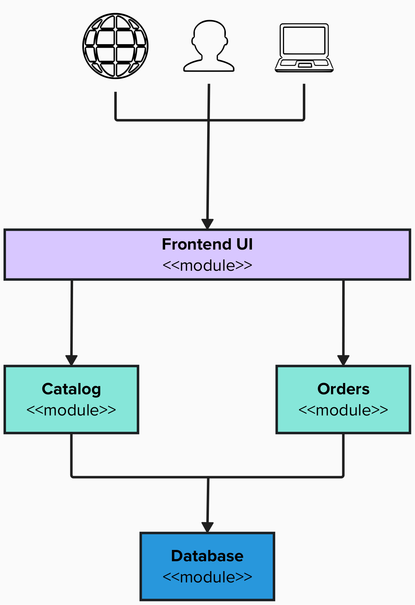

# E-Commerce App: Business Requirements

## The situation

**E-Commerce App** is a clothing store with 500 products. Today it sells only in physical stores: orders are written down by hand and sometimes items that are already out of stock are sold.

The company wants to sell online. Every year it runs a **Black Friday** event where it expects **20 times more visits** than on a normal day.

## What the company needs

An online store where customers can browse the catalog and place an order.

## Who uses it

| Who | What they do |
|---|---|
| **Visitor** | Browses the catalog |
| **Customer** | Places an order and pays for it |

## How it works

1. The visitor opens the store and sees the catalog with prices and stock.
2. They choose products and enter their shipping details.
3. The system charges the order through an **external payment provider**.
4. If the payment is accepted, the system records the order and deducts the stock.

## Application modules

| Module | Purpose |
|---|---|
| **Frontend UI** | Web storefront accessed by users; routes requests to backend services |
| **Catalog** | Handles product listings, descriptions, prices, and stock queries |
| **Orders** | Handles order creation, customer checkout, and payment processing |
| **Database** | Persistent storage for catalog data, inventory, and order records |

## What the system must guarantee

| # | Quality |
|---|---|
| RN1 | **No order is lost**, even if part of the system fails or restarts. |
| RN2 | There are about **100 catalog visits for every purchase**. Browsing the catalog must not slow down purchases. |
| RN3 | On Black Friday the system must **handle 20 times normal traffic** without manual intervention. |
| RN4 | The **payment provider key** and credentials must not appear in the code or in logs. |
| RN5 | If the payment provider fails, **the catalog must continue working**. |
| RN6 | Customers should only access the storefront. **The database must never be accessible from the outside.** |

## What you need to deliver

An OpenShift architecture diagram that includes:

1. The application **components**.
2. Which OpenShift resource you use for each, and **why**.
3. How they communicate with each other.
4. Where data and configuration are stored.
5. What is public and what is internal.
6. What happens on Black Friday.

### Vocabulary

`Route` · `Service` · `Headless Service` · `Deployment` · `StatefulSet` · `Pod` · `ConfigMap` · `Secret` · `PVC` · `HPA`

### Questions to justify your design

- Which components are stateful and which are stateless?
- Which part should scale first on Black Friday?
- How do you prevent someone from accessing the database from the internet?
- Where do you put the payment provider key?
