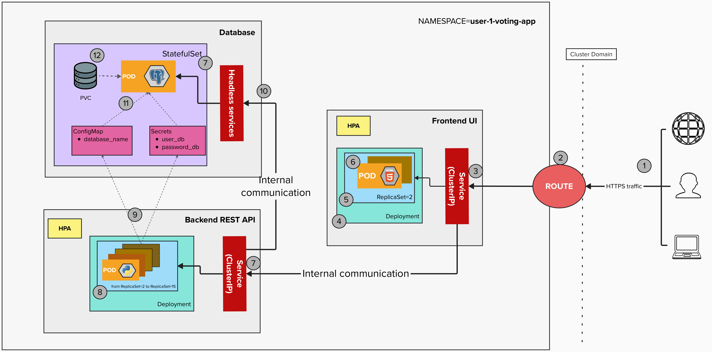

# Voting App: Business Requirements

## The situation

An organization runs an election with **thousands of voters**. Today the vote is done on paper: counting takes days, ballots get lost or duplicated, and nobody can check the result quickly.

## What the organization needs

An online voting system where every voter votes once, and everyone can see the results right away.

## Who uses it

| Who | What they do |
|---|---|
| **Voter** | Votes for a candidate |
| **Anyone** | Looks at the results |
| **Election staff** | Defines the list of candidates before the election |

## How it works

1. The voter opens the voting page.
2. The voter sees the list of candidates.
3. The voter types their name and chooses one candidate.
4. The system records the vote and confirms it.
5. The results are updated.

## Business rules

| # | Rule |
|---|---|
| R1 | Each voter can vote **only once**. |
| R2 | A voter chooses **exactly one** option: a candidate or the blank vote. |
| R3 | The **blank vote** is always available, and it counts in the total. |
| R4 | The names `Ana`, `ana` and ` ANA ` are the **same voter**. |
| R5 | A vote can only go to a candidate who exists in the election. |
| R6 | A vote **cannot be changed or deleted** once it is recorded. |
| R7 | Everyone can see the results at any time, including candidates with zero votes. |

## What the system must do

| # | Requirement |
|---|---|
| RF1 | Show the list of candidates. |
| RF2 | Let a voter enter their name and choose one candidate. |
| RF3 | Record the vote and confirm it to the voter. |
| RF4 | Reject a second vote from the same voter and explain why. |
| RF5 | Reject a vote with an empty name or an invalid candidate, and explain why. |
| RF6 | Show the votes of each candidate and the total, ordered from most to least votes. |
| RF7 | Let anyone refresh the results without voting. |

## What the system must guarantee

| # | Quality |
|---|---|
| RN1 | **No vote is ever lost**, even if a part of the system fails or restarts. |
| RN2 | **No vote is counted twice**, even if many voters vote at the same moment. |
| RN3 | The system must **keep working** when thousands of voters arrive at the same time, for example when the election opens or is about to close. |
| RN4 | The voting page must be **easy to use**: a voter should vote in less than a minute. |
| RN5 | The voters' names must **not be exposed** to other users or written in logs. |

## Initial data

Three options are available when the election opens: **Candidate A**, **Candidate B**, and **Blank vote**.

## Out of scope

- Checking that the person really is who they say they are (no login).
- Changing a vote.
- Creating candidates from the voting page.
- Several elections at the same time.

## Accepted limitations

Because there is no login:

- One person could vote more than once by using different names.
- Two different people with the same name would be treated as one voter.

For this example we accept these risks.

## Solution Architecture

