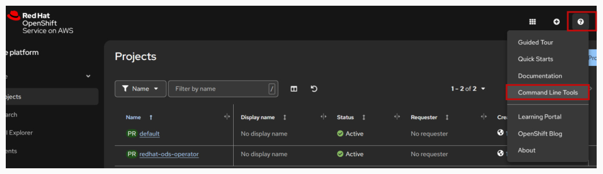
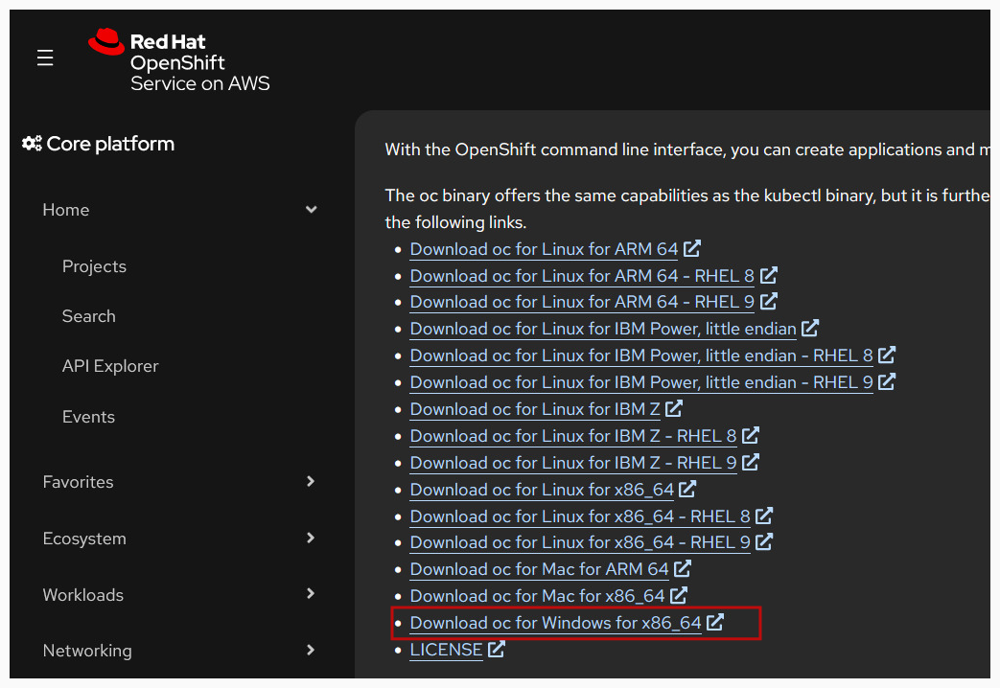
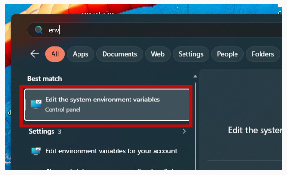
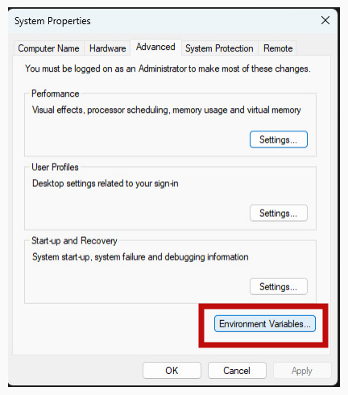
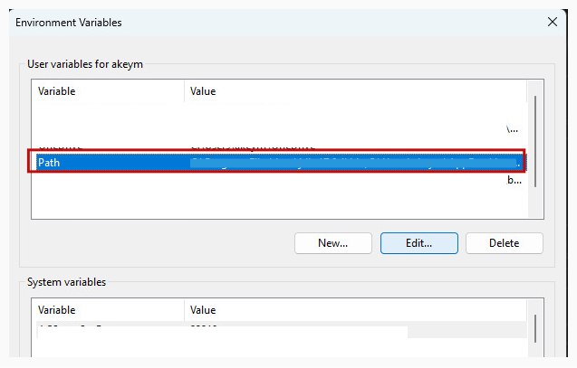
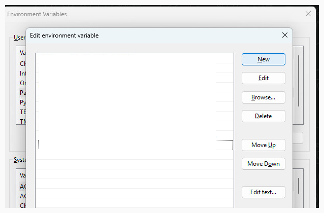

# Pre-Setup Guide: Installing OpenShift CLI (`oc`) on Windows

This guide covers step-by-step instructions for downloading, extracting, and configuring the OpenShift Command Line Interface (`oc`) on **Windows** using the OpenShift Web Console.

---

## Table of Contents

- [Overview](#overview)
- [Step 1 - Access Command Line Tools from OpenShift Web Console](#step-1--access-command-line-tools-from-openshift-web-console)
- [Step 2 - Download the Windows Binary](#step-2--download-the-windows-binary)
- [Step 3 - Extract the Archive](#step-3--extract-the-archive)
- [Step 4 - Open System Environment Variables Settings](#step-4--open-system-environment-variables-settings)
- [Step 5 - Open the Environment Variables Window](#step-5--open-the-environment-variables-window)
- [Step 6 - Edit the User Path Variable](#step-6--edit-the-user-path-variable)
- [Step 7 - Add the `oc` Directory to Path](#step-7--add-the-oc-directory-to-path)
- [Step 8 - Verify the Installation](#step-8--verify-the-installation)

---

## Overview

The OpenShift CLI (`oc`) allows you to manage OpenShift applications and clusters directly from your terminal (Command Prompt, PowerShell, or Windows Terminal). To run `oc` from any terminal location, its directory must be added to your Windows `Path` environment variable.

---

## Step 1 - Access Command Line Tools from OpenShift Web Console

1. Log in to your OpenShift Web Console.
2. In the top-right header, click the **Help** icon (`?`).
3. Select **Command Line Tools** from the dropdown menu.



---

## Step 2 - Download the Windows Binary

1. In the **Command Line Tools** page, locate the OpenShift CLI download links.
2. Click **Download oc for Windows for x86_64** to download the zip file (`openshift-client-windows.zip`).



---

## Step 3 - Extract the Archive

1. Locate the downloaded `.zip` file in your `Downloads` folder.
2. Right-click the `.zip` file and select **Extract All...**.
3. Choose a permanent directory on your machine to store the binary, for example:
   - `C:\oc`
   - or `C:\Program Files\OpenShift-CLI`
   - or `C:\Users\<your-username>\bin`
4. Confirm that `oc.exe` is present in the extracted folder.
5. Copy the full path to this folder (e.g., `C:\oc`).

---

## Step 4 - Open System Environment Variables Settings

1. Press the **Windows Key** or click the Windows search bar.
2. Type `env` or `environment variables`.
3. Click on **Edit the system environment variables** (Control Panel).



---

## Step 5 - Open the Environment Variables Window

1. In the **System Properties** window, make sure you are on the **Advanced** tab.
2. Click the **Environment Variables...** button at the bottom right.



---

## Step 6 - Edit the User Path Variable

1. Under the **User variables for <your-username>** section (top pane), find and select the **Path** variable.
2. Click the **Edit...** button.



---

## Step 7 - Add the `oc` Directory to Path

1. In the **Edit environment variable** window, click the **New** button on the right.
2. Paste the folder path where you extracted `oc.exe` (e.g., `C:\oc`).
3. Click **OK** on the **Edit environment variable** window.
4. Click **OK** on the **Environment Variables** window.
5. Click **OK** on the **System Properties** window to save and apply all changes.



---

## Step 8 - Verify the Installation

1. Open a **new** **Command Prompt (CMD)** or **PowerShell** window (a new window is required to load the updated `Path`).
2. Run the following command:

```powershell
oc version --client
```

Or simply:

```powershell
oc
```

### Expected Output

You should see output similar to:

```text
Client Version: 4.16.x
Kustomize Version: v5.0.4-0.20230601165947-6ce0bf390ce3
```

Or the general help page listing available OpenShift CLI commands:

```text
OpenShift Client

This client helps you manage your applications, deploy containers, build, and configure OpenShift resources...
```

If you see this output, `oc` is successfully installed and ready to use for the workshop!
